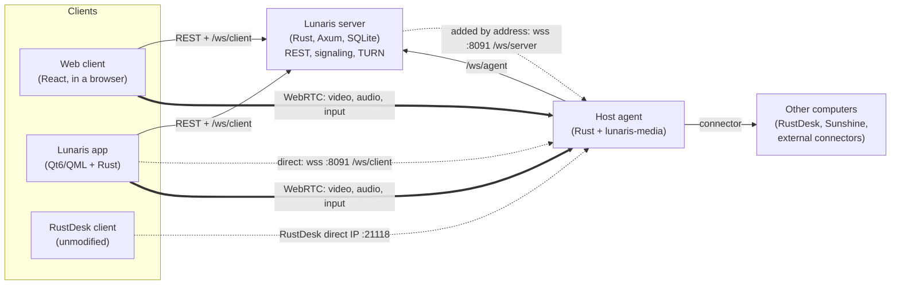
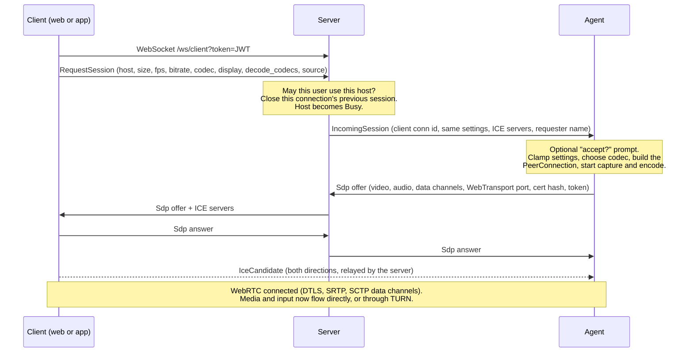

<p align="center">
  
</p>

<h1 align="center">Lunaris</h1>

<p align="center">
  <strong>Open-source remote desktop with gaming-grade streaming performance.</strong>
</p>

<p align="center">
  <a href="#features">Features</a> ·
  <a href="#architecture">Architecture</a> ·
  <a href="#getting-started">Getting Started</a> ·
  <a href="#project-structure">Project Structure</a> ·
  <a href="#data-flow">Data Flow</a> ·
  <a href="#roadmap">Roadmap</a> ·
  <a href="#acknowledgements">Acknowledgements</a>
</p>

---

Lunaris is a fully open-source remote desktop solution that combines the device management convenience of [RustDesk](https://rustdesk.com/) with gaming-grade, GPU-accelerated streaming — accessible from any web browser or native desktop app.

The entire system is written in **Rust** and **TypeScript/React**, optimized for performance and security.

## Features

- **Remote desktop control** — Stream and control any computer from your browser or desktop app.
- **Gaming-grade performance** — GPU-accelerated encoding via the [lunaris-media](https://github.com/collyn/lunaris-media) crate (NVENC, AMF, QuickSync, VAAPI).
- **Multiple clients** — Web client (React) and the native Qt6/QML Lunaris app, which is also the agent and the server in one program.
- **Smart host agent** — Runs headless, as a Windows service, or with a Qt window. Configures and manages the streaming backend automatically.
- **Secure by default** — JWT authentication, bcrypt password hashing, TLS/WSS connections.
- **NAT traversal** — Automatic hole punching with STUN, fallback via TURN relay.
- **Device management** — Web dashboard to manage multiple remote machines with access controls.
- **Remote app launcher** — Browse and launch applications/games on the host from the dashboard.

## Architecture

Lunaris has three kinds of programs. The **server** knows who may use which computer and passes signaling messages. **Agents** run on the computers being controlled. **Clients** (a browser or the native app) show the screen and send input.

The server never carries the video. Audio, video and input go straight between client and agent over WebRTC, or through the server's built-in TURN relay when no direct path exists.



| Component | Path | Tech | Role |
|---|---|---|---|
| **Server** | `server/` | Rust, Axum, SQLite (sqlx), webrtc-rs TURN | Accounts and groups, host directory, REST API, WebSocket signaling, built-in TURN relay, serves the web client (embedded in release builds) |
| **Host agent** | `agent/` | Rust, webrtc-rs, `lunaris-media` | Runs on the controlled computer: capture, encode, RTP, input injection, clipboard, file transfer, connectors |
| **Agent app** | `agent-app/` | Rust, Qt6/QML (cxx-qt) | The standalone agent binary and its settings window (`--cli` runs it headless) |
| **Lunaris app** | `client-qml/` + `client-desktop/` | Rust, Qt6/QML (cxx-qt), FFmpeg, cpal | Native client with hardware video decoding. The `lunaris` binary is also the agent (`lunaris agent`) and the server (`lunaris server`) |
| **Web client** | `web/` | React 19, TypeScript, Vite | Dashboard, admin pages and the in-browser stream viewer |
| **Common** | `common/` | Rust | Shared REST types and the signaling protocol (`SignalingMessage`, `AgentMessage`, ...) |
| **lunaris-media** | *external crate* ([collyn/lunaris-media](https://github.com/collyn/lunaris-media)) | Rust | Screen capture, GPU/software encoding, audio capture and the input injector. It is a git dependency of `agent`, not a folder of this repo |
| **Connector template** | `connectors/template/` | Rust | Minimal external connector and the reference for the connector protocol |

## Getting Started

### Install the server

The server is a single file: accounts, host directory, signaling and the web
client (embedded). Download it from the
[latest release](https://github.com/collyn/lunaris/releases/latest).

**Linux** (static binary, any distro, x86_64 or ARM64):

```bash
curl -L https://github.com/collyn/lunaris/releases/latest/download/lunaris-server-linux-x86_64.tar.gz | tar xz
sudo ./lunaris-server-linux-x86_64/lunaris-server install        # optional: --port 9000
```

`install` copies the binary to `/usr/local/bin`, creates the `lunaris-server`
systemd service (starts at boot, restarts on failure), keeps data in
`/var/lib/lunaris` and settings in `/etc/lunaris/server.env`, then prints the
web address, the **initial admin password** and the agent token.
`lunaris-server status` / `uninstall [--purge]` manage it afterwards.

**Windows**: unzip `lunaris-server-windows-x86_64.zip` and run
`lunaris-server.exe install` from an Administrator prompt (Windows service,
firewall rule, data in `%ProgramData%\Lunaris`).

**Docker**:

```bash
docker compose up -d          # or: docker build -t lunaris-server . && docker run -d -p 8090:8090 -v lunaris-data:/data lunaris-server
docker exec lunaris-server cat /data/initial_admin_password.txt   # initial admin password
docker exec lunaris-server cat /data/server_token.txt             # agent token
```

Then open `http://<server>:8090`, sign in as `admin` with that password
and change it (the server does not write it or the token to its log). Running `lunaris-server` without a command starts it in the
foreground instead.

### Install the app

The **Lunaris app** controls other computers and lets them control this one
(click **Allow remote control**); it is also the agent and the server (see
below). The standalone **agent** is for computers that are only controlled
(servers, headless boxes), and any browser works as a viewer too. From the
[latest release](https://github.com/collyn/lunaris/releases/latest):

| System | App (control and be controlled) | Agent only |
|---|---|---|
| Ubuntu 24.04+, Debian 13+ | `sudo apt install ./lunaris-client_<ver>_amd64.deb` | `sudo apt install ./lunaris-agent_<ver>_amd64.deb` |
| Fedora, Arch and other Linux (glibc 2.35+) | `lunaris-client-desktop-linux.AppImage`, run once with `--setup-host` to be controlled | `lunaris-agent-linux-x86_64.AppImage`, run once with `--setup-host` |
| Windows | `lunaris-client-installer-windows.exe` | `lunaris-agent-installer-windows.exe` |

The distro packages use the system's Qt and PipeWire and carry their own small
static FFmpeg (hardware encoders/decoders, x264, SVT-AV1), so they work the same
on every distro. They also install the uinput udev rule needed for remote
keyboard/mouse. (`.rpm` and Arch packages are prepared in `scripts/packaging/`
and will be published once the PipeWire bindings are updated.)

The app is one program with three modes:

```bash
lunaris-client                    # the app
lunaris-client agent [--cli ...]  # the agent, headless (same options as lunaris-agent)
lunaris-client server [command]   # the server (same commands as lunaris-server)
```

### Connect directly, without a server

On a LAN, a VPN or through a forwarded port, one computer can control another
without a server. On the computer to control, turn on **Allow remote control**
(app, Home) or **Allow direct connections** (agent window): it shows the
computer's addresses (port 8091) and an access password. In the app, type the
address under **Control a remote computer** and enter the password; it then
appears under **Recent** (add it to **Favorites** from its menu). Headless
agents: `lunaris-agent --cli --direct` prints the address and password
(`--direct-port` changes the port). Only the signaling uses this connection
(plain WebSocket, so keep it to trusted networks); video and input stay
end-to-end encrypted WebRTC.

### Prerequisites (building from source)

- **Rust** 1.75+ (with `cargo`)
- **Node.js** 20+ and npm
- **FFmpeg** libraries (for the native desktop client)
- **Qt6** (for the QML desktop client)

### Quick Start

```bash
# Clone the repository
git clone https://github.com/collyn/lunaris.git
cd lunaris

# Use the interactive control panel
./run.sh

# Or run development mode directly (server + web dev server)
./run.sh --dev
```

The `run.sh` script provides several options:

| Flag | Description |
|---|---|
| `--dev` | Run backend (debug) and Vite dev server concurrently |
| `--prod` | Build web assets, then run the server in release mode |
| `--build` | Build the entire workspace (Rust release + web) |
| `--build-web` | Build React frontend only |
| `--build-rust` | Build Rust workspace only (release) |

### Manual Setup

```bash
# Terminal 1 — Start the backend server
cargo run --manifest-path server/Cargo.toml --bin server

# Terminal 2 — Start the web frontend dev server
cd web && npm install && npm run dev

# Open http://localhost:5173 in your browser
```

### Environment Variables

| Variable | Default | Description |
|---|---|---|
| `SERVER_PORT` | `8090` | HTTP port (web client, API, WebSocket signaling) |
| `LUNARIS_HTTPS_PORT` | `8443` | HTTPS port for the web client (`off` disables it). Browsers only allow game controllers, the clipboard API and WebTransport on https pages (or localhost); agents keep using `ws://` on `SERVER_PORT` |
| `LUNARIS_TLS_CERT`, `LUNARIS_TLS_KEY` | *(self-signed)* | PEM certificate and key for HTTPS. Without them a self-signed certificate is made once in the data directory (the browser asks to accept it) |
| `LUNARIS_DATA_DIR` | working directory | Database, agent token and initial admin password (`/var/lib/lunaris` for the service, `/data` in Docker) |
| `LUNARIS_TOKEN` | *(auto-generated)* | Token for agent-to-server authentication |
| `LUNARIS_ADMIN_PASSWORD` | *(random)* | Initial `admin` password — first start only |
| `DATABASE_URL` | `sqlite://<data dir>/lunaris.db` | SQLite database path |
| `RUST_LOG` | `info,server=debug` | Log level configuration |
| `LUNARIS_TURN` | on | Built-in TURN relay (`0` disables it). Lets WebRTC connect through the server when the two sides can't reach each other directly |
| `LUNARIS_TURN_PORT` | `3478` | TURN listening port (UDP) |
| `LUNARIS_TURN_RELAY_PORTS` | `49160-49260` | UDP ports used for relayed streams (open them in the firewall together with the TURN port) |
| `LUNARIS_TURN_PUBLIC_IP` | *(local addresses)* | Address to advertise when the server is behind 1:1 NAT, e.g. a cloud VM |

### Linux Host (X11 and Wayland)

Remote input uses virtual devices on `/dev/uinput` (like Sunshine), which works on X11 and every Wayland compositor. Grant access once:

```bash
sudo scripts/linux-host/setup-host.sh                         # udev rule + load uinput
sudo scripts/linux-host/setup-host.sh --kms target/release/agent  # optional: KMS capture
sudo scripts/linux-host/setup-host.sh --uninstall
```

On Wayland the screen is captured through the XDG desktop portal + PipeWire. The first session asks which monitor to share; the choice is remembered (`~/.config/lunaris/screencast-token`). Frames stay on the GPU end to end (DMA-BUF → VAAPI) when encoding with VAAPI on the GPU that drives the displays.

| Variable | Default | Description |
|---|---|---|
| `LUNARIS_RENDER_NODE` | *(auto: display GPU)* | Render node for VAAPI/EGL, e.g. `/dev/dri/renderD129` |
| `LUNARIS_PIPEWIRE_ZERO_COPY` | `1` | `0` reads frames back to the CPU in the capture thread |
| `LUNARIS_CAPTURE` | *(auto)* | `kms` uses KMS capture on Wayland (needs `--kms` setup above) |
| `LUNARIS_EMBED_HOST_CURSOR` | `0` | `1` draws the cursor into the video instead of the client overlay |

## Project Structure

```
lunaris/
├── server/                     # Rust backend: API, signaling, TURN
│   ├── src/
│   │   ├── main.rs / lib.rs        # Entry point, routes, host list, login, startup
│   │   ├── signaling.rs            # /ws/agent and /ws/client, routing of signaling messages
│   │   ├── auth.rs                 # JWT (7 days) and password hashing (bcrypt)
│   │   ├── security.rs             # Agent keys, rate limits, "may this user use this host"
│   │   ├── db.rs                   # SQLite schema and migrations
│   │   ├── admin.rs                # Users, groups, TURN servers, host key reset
│   │   ├── turn.rs                 # Built-in TURN relay
│   │   ├── links.rs                # Computers added by address (server connects to the agent)
│   │   ├── sources.rs              # Other computers an agent shows through connectors
│   │   ├── queue.rs                # Bounded per-connection send queues
│   │   ├── tls.rs / web.rs         # HTTPS listener, embedded web client
│   │   └── service.rs / paths.rs   # install/uninstall as a system service, data directory
│   └── examples/direct_probe.rs
│
├── agent/                      # Host agent library
│   ├── src/
│   │   ├── lib.rs                  # CLI, server connection, session logic (one stream at a time)
│   │   ├── hub.rs                  # Routes replies to the server, direct clients or links
│   │   ├── direct.rs, direct/      # Direct connections (no server): TLS + password proof
│   │   ├── bridge.rs               # One streaming session: WebRTC, media pipeline, data channels, input
│   │   ├── bridge_agent.rs         # Bridge-only agent (sources only) for the app's own computers
│   │   ├── video/                  # RTP packetizers for H.264, H.265, AV1, VP9
│   │   ├── input.rs, gamepad.rs    # Input packets, virtual game controllers
│   │   ├── share.rs                # Clipboard channel
│   │   ├── files.rs                # File-transfer sessions (own WebRTC connection)
│   │   ├── approval.rs             # "Accept this connection?" prompts
│   │   ├── pairing.rs              # Agent configuration file
│   │   ├── rtcp_forward.rs         # Client RTCP feedback (PLI, FIR, REMB, NACK) to the session
│   │   ├── rustdesk.rs, rustdesk/  # RustDesk-compatible listener (unmodified RustDesk clients)
│   │   ├── connector/              # Connectors: rustdesk, sunshine, external programs
│   │   └── win_service.rs          # Windows service that runs the host as SYSTEM
│   └── proto/rustdesk/message.proto
│
├── agent-app/                  # Standalone agent binary and its Qt window
├── client-qml/                 # Native client library (Rust + Qt6/QML)
│   ├── src/
│   │   ├── lib.rs, bridge.rs       # App core, StreamBridge: sign-in, signaling, WebRTC session
│   │   ├── decoder.rs, *.cpp       # FFmpeg decoding, GPU video items (OpenGL, D3D11, VAAPI)
│   │   ├── audio.rs, input.rs      # Opus playback (cpal), keyboard and mouse mapping
│   │   ├── gamepad.rs, share.rs    # Local controllers, clipboard sync
│   │   ├── files.rs                # File manager connection
│   │   ├── host.rs                 # "This computer": runs `lunaris agent`
│   │   ├── local_server.rs         # "Server on this computer": runs `lunaris server`
│   │   ├── own_computers.rs        # Computers of other types added by the app itself
│   │   └── deeplink.rs             # lunaris:// links
│   └── qml/                        # Home, Dashboard, Settings, FileManager, Admin* pages
│
├── client-desktop/             # The `lunaris` binary: app, `agent` and `server` modes
├── web/                        # React web client
│   └── src/
│       ├── App.tsx                 # Sign-in, computer list, admin, "Add computer"
│       └── components/StreamPlayer.tsx   # WebRTC viewer, input, WebTransport
│
├── common/                     # Shared Rust crate: REST types and the signaling protocol
├── connectors/template/        # Example external connector and protocol reference
├── vendor/ffmpeg-sys-next/     # Patched FFmpeg bindings
├── scripts/                    # linux-host (uinput setup), packaging, brand assets
├── docs/                       # Planning notes (dependency upgrade, video rewrite)
├── Dockerfile, docker-compose.yml
├── run.sh, run.ps1             # Build and run helpers
├── Cargo.toml                  # Workspace (server, agent, agent-app, common, client-desktop, client-qml, connectors/template)
└── project_architecture.md     # Original design notes (Vietnamese)
```

## Data Flow

This section follows one connection from start to finish. File names point to where each step lives.

### 1. Starting up

**Server** (`server/src/lib.rs`, `run_server`)

1. Opens and migrates the SQLite database (`users`, `hosts`, `groups`, `user_groups`, `host_groups`, `turn_servers`, `address_hosts`, `host_sources`). On the first start it creates the `admin` account with a random password and writes it to `initial_admin_password.txt`.
2. Loads or creates the agent token (`server_token.txt`, or `LUNARIS_TOKEN`) and the JWT signing secret.
3. Starts the built-in TURN relay (UDP 3478) and reconnects the computers that were added by address.
4. Serves REST, WebSocket and the web client on HTTP `:8090` and HTTPS `:8443`. Browsers only expose game controllers, the clipboard API and WebTransport on secure pages, which is why HTTPS is on by default (self-signed unless a certificate is given).

**Agent** (`agent/src/lib.rs`, `run_agent`)

The agent loads its config file (`agent_config.json` under `~/.config/lunaris-agent` or `%APPDATA%\lunaris-agent`). Then it starts up to four things around one session loop:

- the direct listener, when direct access is on (port 8091);
- the RustDesk-compatible listener, when `rustdesk_port` is set;
- the server connection, when `server_url` is set;
- `run_session_logic`, which handles one streaming session at a time.

A `Hub` (`hub.rs`) sits in front of the session loop. Whatever the origin of a request (server, direct client, or a server linked by address), the session loop sees the same stream of `SignalingMessage`s and answers with `AgentMessage`s. The hub sends each answer back the way the request came.

### 2. Registering a host

```
Agent  ──  ws(s)://server/ws/agent?id=&name=&codec_support=&token=&key=  ──►  Server
```

1. The server rate-limits failures per address, compares the token in constant time and validates the id and name.
2. **Agent key:** the first key an agent presents for a host id is stored as a SHA-256 hash. After that, only the same key can register that id. An admin can reset it (`POST /api/admin/hosts/{id}/reset-key`).
3. Over `wss://` the agent checks the server certificate against the system roots. A self-signed certificate is pinned on first use (`server_cert_sha256`), and a changed certificate is refused.
4. `agent_connected` adds the agent to the server's `agents` map and marks the host **Online** in `hosts`, along with the codecs it can encode in real time (`codec_support`). That value comes from probing the encoders: H.264 is offered whenever any encoder supports it (software counts), and H.265 and AV1 only when a hardware encoder really opens at 1080p60.
5. The agent announces its sources and connector types (see section 10). The server pings every 15 seconds. If the connection drops, the agent retries every 3 seconds, and the host goes **Offline** and its clients get "Host disconnected".

### 3. Signing in and listing computers

1. `POST /api/auth/login` checks the password with bcrypt (unknown users are checked against a dummy hash so timing does not reveal them). Failures are limited per address and per user and address. A success returns a JWT valid for 7 days.
2. Every REST call and WebSocket connection verifies the token, then re-reads the user row. A deactivated or deleted user is refused even with a valid token, and the role in the token is not trusted.
3. `GET /api/hosts` returns every host to an admin, and for other users only the hosts of their groups (`user_groups` joined with `host_groups`). Each host is **Busy** while it streams, **Online** while its agent is connected, otherwise **Offline**.

### 4. Starting a session (signaling)

The agent creates the WebRTC offer, and the client answers it.



Details worth knowing:

- The server renames ids as it forwards. Clients address a host by `host_id`, and agents address a client by its connection id. Every client message that names a host is checked with `may_use_host` first.
- An agent runs **one stream at a time**. A new request replaces the old one. The server waits 1.3 s after stopping a previous session, and the agent waits at least 1.2 s between streams so the encoder can release its resources.
- The agent clamps what it is asked for (sizes 64 to 8192 and even, 1 to 240 fps, 500 to 500 000 kbps). If H.265 or AV1 was requested but no hardware encoder opens, it falls back to H.264. YUV 4:4:4 forces H.264 High 4:4:4.
- `decode_codecs` tells the host what the client can decode, so a connector source can send a codec the viewer understands.
- The same signaling path carries `GetCapabilities` (displays, encoders, GPU, host OS, sources), `GetAppList`, `StopActiveStream`, `EndSession`, `AccessRequest` (waiting, denied, timeout) and `SourceStatus`.

### 5. Streaming

```
Display ──► lunaris-media capture ──► encoder (H.264 / H.265 / AV1)
                                          │  NVENC, AMF, QuickSync, VAAPI or software
                                          ▼
                             agent/src/video packetizers (RTP)
                                          │
                              "rtp-writer" thread (paced like Sunshine)
                                          ▼
                       WebRTC (SRTP) ──► client decodes and renders
Audio  ──► lunaris-media ──► Opus ──► RTP audio track ──► client playback
```

- **Pacing and latency.** A dedicated `rtp-writer` thread spreads each frame's packets over the frame interval. It sets the playout-delay header extension to 0 so browsers keep no jitter buffer, and adds an absolute-send-time extension for bandwidth estimation. If the queue grows too long, old frames are dropped and a key frame is requested. Forward error correction (FlexFEC-03) is optional (`LUNARIS_FEC=1`).
- **Feedback from the client.** `rtcp_forward.rs` passes the client's RTCP to the session. PLI and FIR trigger a key frame, REMB changes the bitrate, and NACK is answered by the stack. Messages on the `general` channel (`set_bitrate`, `set_fps`, key frame) do the same on demand.
- **Decoding.** The web client uses the browser's own decoder and a `<video>` element. The Lunaris app decodes with FFmpeg and tries hardware decoders first (VAAPI, CUDA, and so on), then draws through GPU video items that avoid copying the frame to the CPU where it can.

**Data channels** (created by the agent for each session):

| Channel | Delivery | Direction | Content |
|---|---|---|---|
| `general` | reliable | both | Settings commands from the client (bitrate, fps, key frame) and host cursor messages |
| `cursor` | unordered, no retransmit | host → client | Host cursor shape and state |
| `mouse_absolute`, `mouse_relative` | unordered, no retransmit | client → host | Pointer position and motion |
| `mouse_reliable` | reliable, unordered | client → host | Buttons and wheel |
| `keyboard` | reliable, ordered | client → host | Key events (a lost release would leave a key held) |
| `clipboard` | reliable, ordered | both | Text, when `allow_clipboard` is on (`share.rs`) |
| `gamepad` | unordered, no retransmit | client → host | Controller state, shown on the host as a virtual Xbox 360 pad (uinput on Linux, ViGEmBus on Windows) |

**Input.** The agent injects input on dedicated OS threads (`lunaris-mouse-input`, `lunaris-key-input`) through the `lunaris-media` input injector. On Linux that needs access to `/dev/uinput` (see Linux Host above), and X11 also needs the XTest extension. Key codes are Windows virtual-key codes. When the session ends, the agent releases every key the viewer still held.

**WebTransport (optional).** For each session the agent can open a QUIC endpoint with a self-signed certificate. Its port, certificate hash and a secret URL token travel in the SDP message. A client may then send input datagrams over it to avoid SCTP head-of-line blocking. The endpoint accepts one authenticated connection and locks itself after repeated failed handshakes. Keys still prefer the reliable data channel.

### 6. Ending a session

A session ends when the client sends `EndSession`, when its WebSocket closes, when the agent receives `StopActiveStream`, or when the agent disconnects. The server then tells the other side, closes the peer connection and sets the host back to **Online**. Only the connection that owns a session can end it. A second client that only asked for the display list cannot cut the stream.

### 7. File transfer

File transfer uses its own signaling WebSocket and its own WebRTC connection. Big transfers never queue behind the video or the input, and files can be moved without watching the screen.

1. The client sends `RequestFileSession` on a dedicated connection. The server checks access and forwards `IncomingFileSession`.
2. The agent answers with an offer that carries one reliable, ordered `files` data channel (`agent/src/files.rs`).
3. On that channel, the client sends JSON requests (`hello`, `list`, `walk`, `mkdir`, `remove`, `rename`, and so on), each with an `id`, and file contents move as binary chunks.
4. The agent's `allow_file_transfer` and `file_access` settings decide what is reachable. `file_access` is a folder, `home` (the default) or `full`, and the Windows service agent defaults to `full`.

### 8. Who is allowed in

| Layer | Rule |
|---|---|
| Server account | Sign-in with rate limiting. Admins see all hosts, other users only the hosts of their groups. |
| Agent to server | Shared agent token plus a per-host key. `wss://` with certificate pinning. |
| Agent, sessions through the server | `server_sessions`: `trusted` (default) lets in whoever the server lets through. `ask` puts every screen or file session to the person at the computer first (`ServerGate` in `lib.rs`). |
| Agent, direct access | `approve_mode`: `password`, `click` (the person at the computer accepts) or `password-click` (either, the default). Screen and files are asked for separately. |
| Approval prompts | The app shows them. The agent started with `--approval-stdio` writes each question to stdout and reads the answer from stdin (`approval.rs`). |
| Clipboard, files | Each can be turned off on the agent. |

### 9. Direct connections and computers added by address

**Direct (no server).** The agent listens on port 8091 (`agent/src/direct.rs`) and speaks the same client protocol as the server. A client connects to `wss://<agent>:8091/ws/client`. Only signaling uses this socket. Video, audio and input still go over WebRTC.

- The port uses TLS with a self-signed certificate made at start.
- The password never crosses the network. The client proves it knows it with an HMAC-SHA256 that includes the certificate hash (channel binding, `direct/handshake.rs`), so a man in the middle without the password cannot pass.
- Without a password, the person at the computer accepts each connection.
- Wrong passwords lock the address out, and unauthenticated connections and prompts are capped.
- Older clients can still use plain `ws://...?token=<password>` on the same port.

**Added by address (server to agent).** An admin can add a computer with `POST /api/hosts/address`. The server stores it in `address_hosts` and connects to the agent's `/ws/server` endpoint (`server/src/links.rs`), retrying every few seconds. From then on it is treated like an agent that connected by itself: it shows in the list and works from every client. This is useful when the computer cannot reach the server but the server can reach it.

### 10. Other computers: sources and connectors

An agent can show computers that speak other protocols, listed beside its own screen. Each one is a **source**, reached through a **connector** (`agent/src/connector/`).

| Connector | What it does |
|---|---|
| `rustdesk` | The agent acts as a RustDesk client and connects to a RustDesk host by IP address (direct IP access, TCP 21118). |
| `sunshine` | The agent acts as a Moonlight (GameStream) client of a Sunshine host. It pairs with a PIN typed at the other computer, then receives video and audio and sends input. |
| external | Any program in `<agent data dir>/connectors/<id>/` with a `connector.json`, speaking a framed protocol over stdin and stdout. See `connectors/template/README.md`. |

- **Managing sources.** `/api/sources`, `/api/connectors` and `/api/hosts/{id}/sources` let admins add, edit and remove sources. The server sends the agent a `ChangeSource` message. The address and password pass through the server once and are kept only in the agent's config. The server keeps just the id, name, type and host (`host_sources`). A set-up that needs a PIN is polled with `.../sources/setup/{setup}`.
- **Session with a source.** The client sends `RequestSession` with a `source_id`. The agent logs in through the connector and forwards the other computer's already-encoded video and audio into its RTP track, without decoding or re-encoding. The viewer's input goes to the connector, never to this computer's screen, keyboard or clipboard. If the source cannot be reached, the client gets `SourceStatus` (`failed` or `ended`), and the agent never shows its own screen in its place.
- **Computers added by the app itself.** The Lunaris app can add such computers for itself. It starts a helper (`lunaris agent --cli --bridge-only`) that listens only on `127.0.0.1` with a one-time password and shows sources only (`agent/src/bridge_agent.rs`, `client-qml/src/own_computers.rs`).
- **RustDesk clients connecting in.** With `rustdesk_port` set, the agent also accepts unmodified RustDesk clients at its address (default port 21118). They see the screen, mouse, keyboard, cursor, clipboard text, sound and, if enabled, files. RustDesk ids and relay servers are not supported.

### 11. NAT traversal

1. ICE tries direct paths first (host and server-reflexive candidates). With no custom TURN servers configured, the server hands out Google STUN servers. Admins can add their own in `turn_servers`.
2. The server also runs a TURN relay (UDP 3478, relay ports 49160 to 49260). It hands each peer the relay at the address that peer used to reach the server, with short-lived HMAC credentials, and only to users who may use the host. If ICE cannot connect directly, media flows through this relay.
3. The relay never sends to loopback, link-local or unspecified addresses, so it cannot be used to reach services on the server itself.
4. Set `LUNARIS_TURN_PUBLIC_IP` when the server is behind 1:1 NAT (for example a cloud VM), and open the TURN and relay ports in the firewall.

### 12. One program, three modes

The `lunaris` binary (`client-desktop/src/main.rs`) starts the desktop app by default. `lunaris agent` runs the agent headless and `lunaris server` runs the server. Inside the app:

- **This computer** (`host.rs`) runs `lunaris agent --cli` as a child process, so a capture or encoder failure cannot take the app down. It shares the standalone agent's config file.
- **Server on this computer** (`local_server.rs`) runs `lunaris server run`, with its data in the per-user data directory.
- **Connecting** goes to a server (`/api/auth/login`, then `/ws/client`) or straight to an agent (`agent::direct::connect`). `lunaris://connect?...` links connect at once only to the server the user is signed in to. Any other server waits for confirmation and gets no clipboard sync or file transfer (`deeplink.rs`).

## Roadmap

- [x] Core WebRTC streaming and web client MVP
- [x] Central server with Axum, SQLite, and JWT auth
- [x] Host agent with a desktop window (Qt)
- [x] Qt6/QML desktop client with hardware video decoding
- [x] lunaris-media native capture and encoding backend
- [x] NAT traversal: STUN plus a built-in TURN relay in the server
- [x] Direct connections to an agent without a server
- [ ] File transfer via WebRTC Data Channel
- [ ] Bidirectional clipboard sync
- [ ] Multi-monitor support

## Acknowledgements

Lunaris stands on the shoulders of several excellent open-source projects. Special thanks to:

- **[RustDesk](https://rustdesk.com/)** — Inspiration for the device management model and user experience.

## License

Lunaris is licensed under the **GNU General Public License v3.0 or later** (`GPL-3.0-or-later`) — see [LICENSE](LICENSE).
Releases before this change were published under the MIT licence.

Prebuilt packages bundle third-party components (Qt, FFmpeg, x264, …); see
[`scripts/packaging/THIRD-PARTY-NOTICES.md`](scripts/packaging/THIRD-PARTY-NOTICES.md).
